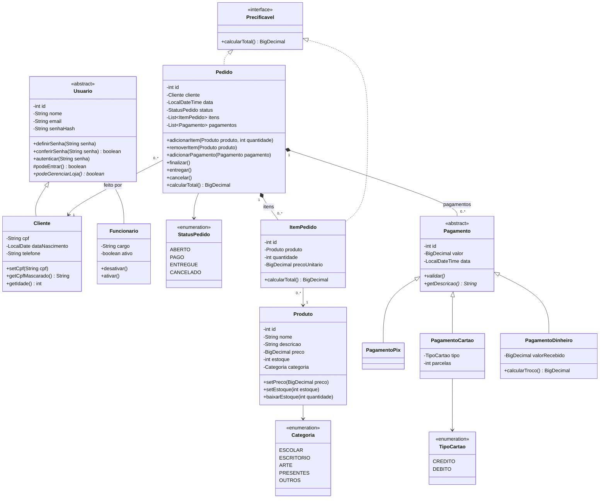
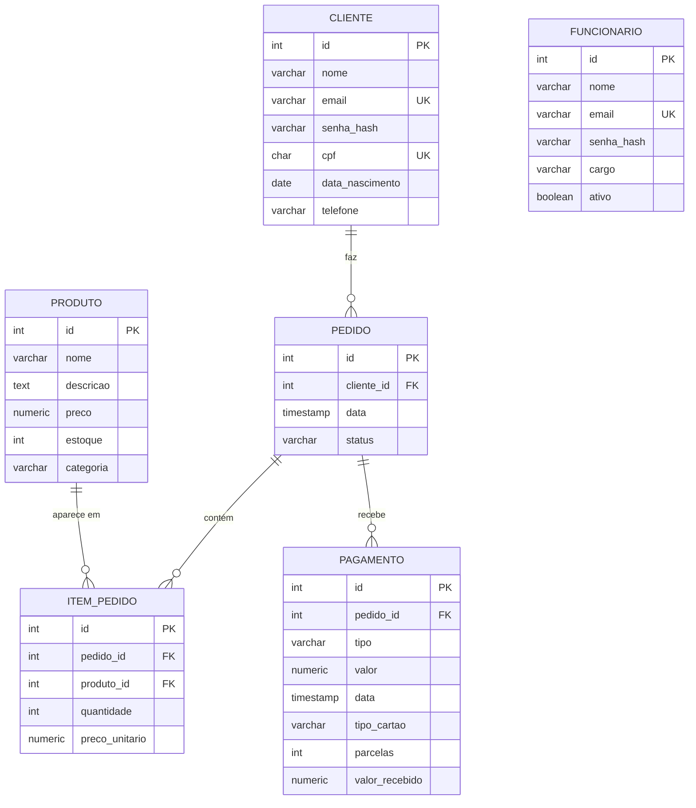

# 🧩 Modelo do Sistema
← [README](../README.md) · [Visão do projeto](visao.md) · [Regras de negócio](regras-de-negocio.md)

> Versão inicial (checkpoint de 11/11). Pode mudar durante o projeto, mas no final **tem que bater com o código**.

## 📐 Diagrama de classes



**Exceções** (pacote `exception`):
- `EstoqueInsuficienteException`: pedir mais unidades do que tem em estoque
- `PagamentoInvalidoException`: pagamento que quebra a própria regra (ex: débito parcelado, dinheiro que não cobre o valor)
- `LoginInvalidoException`: e-mail ou senha errados, ou funcionário desativado

> Entrada inválida (preço negativo, e-mail sem @, CPF errado) usa a `IllegalArgumentException` do próprio Java. As exceções personalizadas ficam pras **regras de negócio**.

**Segurança** (pacote `seguranca`): a classe `HashSenha` gera e confere o hash das senhas com PBKDF2, que já vem no Java.

## 🔐 Login e áreas do sistema
| Área | Quem entra | O que faz |
|---|---|---|
| **Compras** | Cliente | Vê os produtos, monta o carrinho (pedido `ABERTO`) e paga |
| **Gestão** | Funcionário ativo | Cadastra produtos, clientes e funcionários e acompanha os pedidos |

- A área é decidida pelo **tipo do usuário** (`podeGerenciarLoja()`), e não por um campo de permissão.
- Cliente e funcionário ficam em **tabelas separadas**: uma conta de cliente nunca vira conta de funcionário.

## 🗄️ Modelo do banco



- **Os 3 tipos de pagamento ficam numa tabela só**, com a coluna `tipo` (`PIX`, `CARTAO`, `DINHEIRO`). As colunas que não servem pra um tipo ficam vazias. É a forma mais simples de guardar uma hierarquia no banco quando os tipos são consultados juntos.
- **Já os usuários ficam em 2 tabelas** (`cliente` e `funcionario`), mesmo sendo uma herança no Java: são contas que nunca podem se misturar.
- `item_pedido` não aceita o mesmo produto duas vezes no mesmo pedido (`UNIQUE (pedido_id, produto_id)`): adicionar de novo aumenta a quantidade.

## 📏 Regras de negócio
As regras (RN01 a RN15) estão em [regras-de-negocio.md](regras-de-negocio.md). No código, os comentários usam os mesmos códigos.

O banco também garante parte delas: `UNIQUE` no e-mail e no CPF (RN02, RN11), um índice que só permite 1 pedido `ABERTO` por cliente (RN03) e `CHECK` em preço, estoque, quantidade, telefone, CPF e pagamentos.

### 🔄 Vida de um pedido, no código
```
ABERTO (carrinho) ──finalizar()──▶ PAGO ──entregar()──▶ ENTREGUE
      └──cancelar()──▶ CANCELADO
```

## 🎓 Conceitos de POO (pra tabela do artigo)

| Conceito | Onde | Por quê |
|---|---|---|
| Encapsulamento | Atributos `private`; `setPreco`, `setEstoque`, `setEmail` e `setCpf` validam; `precoUnitario` **não tem setter**; a senha **nunca é guardada**, só o `senhaHash` | Os objetos nunca ficam em estado inválido, e o pedido antigo não muda se o preço mudar |
| Herança | `Usuario` → `Cliente` e `Funcionario`; `Pagamento` → `PagamentoPix`, `PagamentoCartao` e `PagamentoDinheiro` | Cada um **é um** usuário (ou pagamento), com o seu próprio comportamento |
| Classe abstrata | `Usuario` e `Pagamento` | Não existe "usuário genérico" nem "pagamento genérico" |
| Polimorfismo | `podeGerenciarLoja()` decide a área de cada usuário; `Pedido.finalizar()` chama `validar()` em cada item da `List<Pagamento>` | Cada tipo responde do seu jeito |
| Interface | `Precificavel`, em `Pedido` e `ItemPedido` | Os dois têm um valor total |
| Composição | `Pedido` ◆ `ItemPedido` e `Pedido` ◆ `Pagamento` | Item e pagamento não existem sem o pedido |
| Exceção personalizada | `EstoqueInsuficienteException`, `PagamentoInvalidoException` e `LoginInvalidoException` | Regras de negócio mostradas na tela |

### Por que o modelo é assim
- **`Produto` não tem subclasses:** caneta e caderno se comportam igual no sistema; só os dados mudam. Herança é pra quando o **comportamento** muda, então a diferença virou o atributo `categoria`.
- **Crédito e débito são atributo, não classe:** pela mesma regra, só muda o número de parcelas.
- **Não tem classe `Carrinho`:** o carrinho é o pedido `ABERTO` (RN03). Uma classe separada repetiria `Pedido` e `ItemPedido`.
- **A permissão vem do tipo do usuário**, não de um atributo: um cliente não vira funcionário mudando um campo.
- **Senha com hash, não criptografia:** criptografia pode ser desfeita com a chave; hash não volta. O PBKDF2 usa salt e 600 mil repetições, pra deixar ataques de força bruta lentos.
- **Dinheiro em `BigDecimal`, não `double`:** `double` erra centavos (`0.1 + 0.2` dá `0.30000000000000004`).
